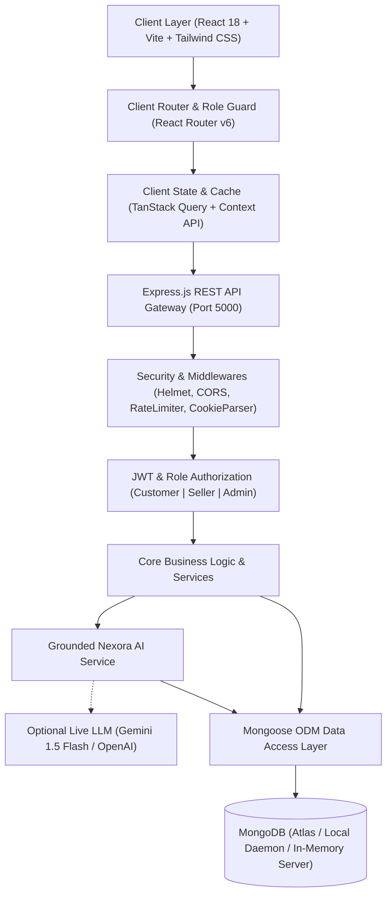

# NEXORA — AI Commerce Cloud: System Architecture

## 1. High-Level System Architecture

NEXORA adopts a decoupled modern full-stack web architecture designed for multi-tenant scalability, rapid developer onboarding, and grounded AI assistance.

---

## 2. Component Breakdown

### A. Client Layer (`client/`)
- **React 18 with Vite**: Bundled with ESBuild for lightning-fast HMR and optimized production treeshaking.
- **Tailwind CSS & Design Tokens**: Custom color palette (Deep midnight navy `#0B0F19`, electric violet `#7C3AED`, indigo `#4F46E5`, cyan `#06B6D4`).
- **State & Data Caching**: TanStack Query (`@tanstack/react-query`) handles remote query caching, deduplication, and optimistic updates.
- **Authentication Persistence**: Session state synced via `AuthContext` with secure HTTP-only cookie extraction and localStorage Bearer fallback.
- **Cart & Wishlist Engine**: Managed through reactive `CartContext` with real-time stock ceiling validation and subtotal recalculation.

### B. Server Layer (`server/`)
- **Express.js with TypeScript**: Fully typed RESTful service structured cleanly into controllers, routes, middleware, validators, and models.
- **Centralized Error Handling**: Intercepts Mongoose unique index violations (`11000`), Zod validation issues, and invalid ObjectId cast exceptions into structured error payloads.
- **Role-Based Access Control (RBAC)**: Backend enforcement via `authenticate` and `requireRole(['seller', 'admin'])`.
- **Zod Schema Validation**: Request payload sanitation ensuring non-negative prices, valid email structures, and preventing public self-assignment of administrative roles.

### C. Grounded AI Engine (`server/src/services/aiService.ts`)
- **Catalog Grounding**: Before any recommendation is generated, candidate products are indexed directly from MongoDB.
- **Budget Extraction**: Natural language regex extracts budget phrases (e.g., "under ₹3,000", "below 10000").
- **Zero-API-Key Demo Engine**: If no Gemini or OpenAI key is present in environment variables, the system executes an intelligent, deterministic semantic scoring model over MongoDB documents, eliminating vendor API reliance during demonstrations.

### D. Zero-Config Embedded Database Engine
- **Auto-Switching Persistence**: If an external MongoDB instance is not detected on `127.0.0.1:27017` or Atlas, the server auto-boots `mongodb-memory-server` and triggers the 26-product multi-vendor seed script automatically.
