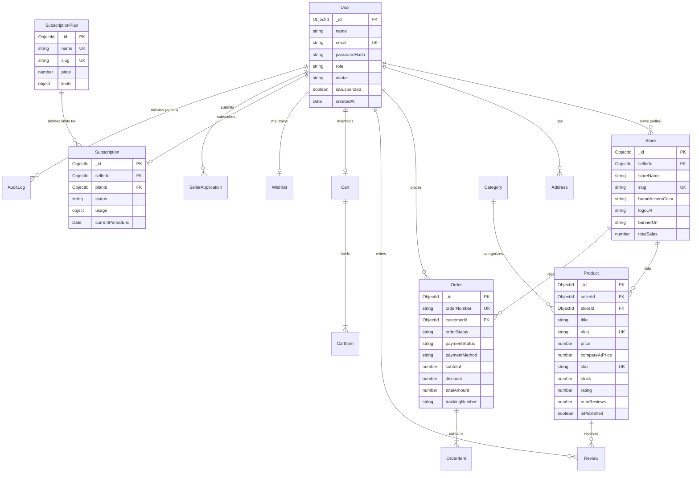

# NEXORA — AI Commerce Cloud: Database Design & Schema Specifications

## 1. Entity-Relationship Diagram (ERD)

---

## 2. Model Specifications & Index Strategy

### 1. `User` Collection
- **Indexes**:
  - `{ email: 1 }` (Unique)
  - `{ role: 1 }`

### 2. `Store` Collection
- **Indexes**:
  - `{ sellerId: 1 }` (Unique)
  - `{ slug: 1 }` (Unique)

### 3. `Product` Collection
- **Compound Indexes**:
  - `{ isPublished: 1, category: 1, price: 1, rating: -1 }`
  - `{ title: "text", description: "text", brand: "text", tags: "text" }`
  - `{ sku: 1 }` (Unique)
  - `{ slug: 1 }` (Unique)

### 4. `Order` Collection
- **Indexes**:
  - `{ orderNumber: 1 }` (Unique)
  - `{ customerId: 1, createdAt: -1 }`
  - `{ sellerIds: 1, createdAt: -1 }`
  - `{ orderStatus: 1 }`

### 5. `Review` Collection
- **Indexes**:
  - `{ productId: 1, customerId: 1 }` (Unique compound index to ensure one review per user per product)

### 6. `SubscriptionPlan` & `Subscription` Collections
- Enforces multi-tenant resource limits: `maxProducts`, `maxMonthlyAiRequests`, and entitlement toggles (`advancedAnalytics`, `customStoreBranding`).

### 7. `Coupon` Collection
- **Indexes**:
  - `{ code: 1 }` (Unique)
- Auto-validation against `minOrderValue`, `expiresAt`, and `usageLimit`.

### 8. `AIUsage` Collection (Audited Token Accounting)
- **Indexes**:
  - `{ userId: 1, createdAt: -1 }` (Compound index for monthly quota aggregation)
  - `{ createdAt: -1 }` (Platform telemetry sorting)
  - `{ model: 1, requestStatus: 1 }`
- **Fields**: `userId`, `accountId`, `conversationId`, `model`, `inputTokens`, `outputTokens`, `totalTokens`, `cachedTokens`, `requestStatus`, `estimatedCost`, `mode`.
