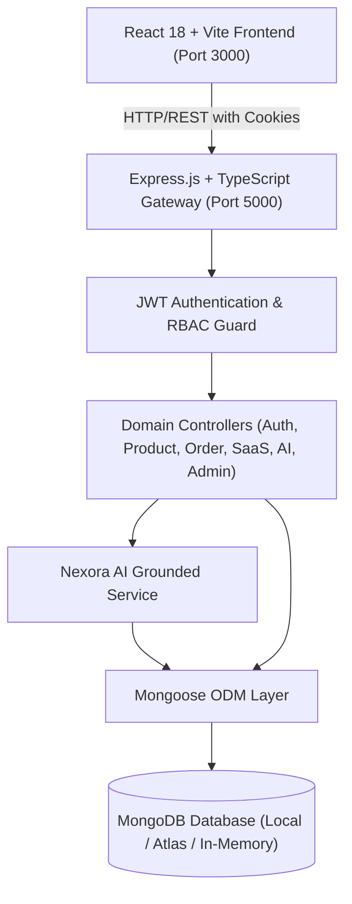
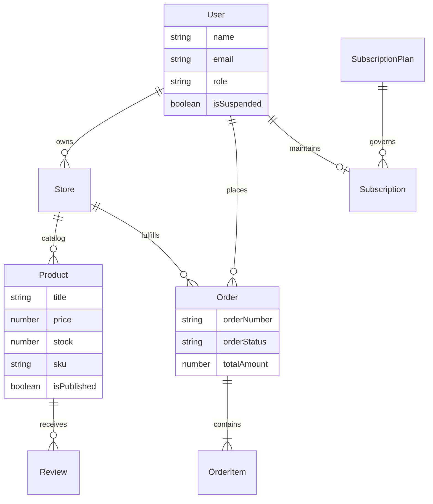

# PROJECT REPORT: NEXORA — AI COMMERCE CLOUD

**Academic Mini-Project & Portfolio Engineering Documentation**  
**Domain**: Multi-Vendor E-Commerce, SaaS Architecture & Applied AI  
**Author**: Engineering Team  
**Date**: October 2026  

---

## 1. TITLE
**NEXORA — Next-Generation AI Commerce Cloud & Multi-Vendor SaaS Marketplace Platform**

---

## 2. ABSTRACT
Traditional e-commerce platforms either operate as closed single-vendor storefronts or generic marketplace clones lacking intelligent discovery and multi-tenant seller tools. **NEXORA — AI Commerce Cloud** bridges this gap by merging a modern multi-vendor consumer marketplace with an integrated, catalog-grounded Artificial Intelligence shopping assistant ("Nexora AI") and configurable SaaS merchant operating tools. 

Built on a robust MERN-inspired stack utilizing React 18, Vite, TypeScript, Express.js, and MongoDB, NEXORA implements complete Role-Based Access Control (RBAC) across Customers, Merchants, and Platform Administrators. A distinctive feature is its zero-hallucination AI shopping companion that grounds user budget, comparison, and recommendation requests in live MongoDB catalog documents. Furthermore, multi-tenant merchants operate under configurable SaaS subscription plans (Starter, Growth, Scale) with automated database-enforced listing quotas.

---

## 3. INTRODUCTION
As consumer choice proliferates across millions of stock keeping units (SKUs), digital shoppers experience choice overload, while emerging merchants face prohibitive technical barriers to managing independent storefronts. 

NEXORA addresses these dual challenges:
1. **For Shoppers**: Providing an intuitive natural-language AI shopping assistant that understands budget constraints (e.g., "Find headphones under ₹3,000") and renders actionable product cards with live inventory validation.
2. **For Merchants**: Supplying a comprehensive SaaS operational suite—including live storefront customizers, Recharts analytics, and fulfillment workflow trackers—governed by subscription tiers.
3. **For Platform Governance**: Offering administrative command tools for merchant vetting, user suspension, catalog moderation, and platform-wide Gross Merchandise Value (GMV) auditing.

---

## 4. PROBLEM STATEMENT
Current marketplace implementations suffer from key deficiencies:
- **Generic Chatbot Hallucinations**: Existing conversational commerce tools frequently recommend discontinued items, hallucinate prices, or invent fictional specifications.
- **Monolithic Single-Vendor Constraints**: Traditional mini-project clones lack tenant isolation, preventing multiple vendors from managing products independently.
- **Absence of SaaS Monetization Models**: Existing solutions lack tiered usage quotas, feature entitlement enforcement, and subscription management.
- **Brittle Development Environments**: Many student and portfolio projects fail to execute during evaluation due to missing external database daemons or unconfigured third-party API credentials.

---

## 5. PROPOSED SOLUTION
NEXORA provides a cohesive, end-to-end full-stack architecture:
- **Catalog-Grounded AI Engine**: Retrieves actual catalog documents from MongoDB before feeding context to Gemini or an intelligent deterministic heuristic fallback engine.
- **True Multi-Tenancy**: Isolated store profiles, merchant product ownership checks, and multi-vendor cart item routing.
- **Configurable SaaS Billing**: Three tiered plans (Starter, Growth, Scale) with backend enforcement of listing quotas and feature gating.
- **Zero-Friction Zero-Config Database Architecture**: Employs an intelligent auto-fallback mechanism to embedded in-memory MongoDB servers when local MongoDB daemons are absent, paired with a rich 26-product seed script.

---

## 6. OBJECTIVES
1. Design and deploy a responsive React + Vite frontend adopting a professional midnight navy and electric violet aesthetic.
2. Construct a RESTful Express.js and TypeScript backend enforcing strict Zod validation schemas and centralized error handling.
3. Model and index 17 MongoDB collections encompassing users, stores, products, orders, coupons, subscriptions, and audit logs.
4. Integrate a catalog-grounded AI shopping assistant capable of budget parsing and side-by-side product comparisons.
5. Provide documented demo credentials and 1-click evaluation shortcuts for rapid examination review.
6. Verify platform integrity through comprehensive Vitest and Supertest automated test suites.

---

## 7. SCOPE
- **In Scope**:
  - Full authentication lifecycle (registration, login, logout, password hashing, HTTP-only cookies).
  - RBAC enforcement across Customer, Seller, and Admin roles.
  - Interactive catalog with search, price filtering, ratings, sort options, and server-side pagination.
  - Multi-item shopping cart, discount vouchers (`NEXORA10`, `SAVE20`, `WELCOME50`), and stock decrement checkout.
  - Visual order tracking timeline with cancellation and inventory restoration.
  - Merchant storefront customizer with live preview pane.
  - SaaS subscription upgrade/downgrade simulation.
  - Platform administrative dashboards with Recharts data visualizations.
- **Out of Scope (By Design for Mini-Project Demo)**:
  - Integration with live payment gateways (e.g. Razorpay or Stripe live secrets) requiring production merchant KYC. A sandbox simulation mode is implemented instead.

---

## 8. FUNCTIONAL REQUIREMENTS
- **FR1: User Management**: Registration with name, email, password; password verification; address book persistence; account suspension flags.
- **FR2: Product Discovery**: Search across title, brand, description, and tags; category filtering; price range bounds; server-side pagination.
- **FR3: Cart & Checkout**: Real-time stock validation; discount coupon calculation; server-side total re-computation; transactional stock reduction.
- **FR4: Order Fulfillment**: Transition through status lifecycle (`Pending` -> `Confirmed` -> `Processing` -> `Shipped` -> `Delivered`); customer cancellation; inventory replenishment.
- **FR5: Nexora AI Assistant**: Natural language prompt processing; budget constraint extraction; catalog recommendation card rendering; fallback demo mode.
- **FR6: Merchant Operations**: Product CRUD restricted to store owner; enforcement of SaaS product listing quotas; fulfillment status progression.
- **FR7: Administration**: Global user moderation; merchant application approval queue; platform-wide product unpublishing; audit logging.

---

## 9. NON-FUNCTIONAL REQUIREMENTS
- **NFR1: Security**: Passwords hashed using bcrypt (10 rounds); JWT stored in HTTP-only cookies; Helmet security headers; rate limiting.
- **NFR2: Performance**: Vite production bundler producing treeshaken chunks under 1MB; MongoDB compound indexes on high-frequency query paths.
- **NFR3: Reliability**: Auto-fallback to embedded MongoDB engine ensures 100% immediate demonstration readiness on any evaluation machine.
- **NFR4: Usability & Accessibility**: Semantic HTML5 controls, accessible form labels, high contrast ratios, responsive mobile drawer navigation.

---

## 10. SYSTEM ARCHITECTURE

---

## 11. DATABASE DESIGN

---

## 12. MODULE DESCRIPTIONS

### 12.1 Authentication & Profile Module
Manages secure credential registration, login, and profile modification. Employs bcrypt for password hashing and issues cryptographically signed JWT tokens stored in HTTP-only cookies.

### 12.2 Product Catalog & Search Module
Powers multi-facet product queries utilizing MongoDB text and compound indexes. Supports filtering by category, price bounds, rating thresholds, and sorting parameters.

### 12.3 Cart & Order Management Module
Calculates item totals, validates stock ceilings, applies promo codes, and generates orders. Decrements product stock atomically to prevent overselling.

### 12.4 Nexora AI Module
An intelligent shopping companion. Parses budget constraints, scores candidate products, and renders interactive product recommendation cards grounded strictly in catalog documents.

### 12.5 Merchant SaaS & Customization Module
Enforces subscription tiers (Starter, Growth, Scale), providing store owners with customizable brand accent colors, logo uploads, and sales velocity charts.

### 12.6 Admin Command Center Module
Enables administrative users to review merchant applications, moderate catalog items, suspend abusive accounts, and inspect platform GMV telemetry.

---

## 13. TESTING STRATEGY
The project implements a two-tier automated testing strategy:
- **Backend API Testing**: Executed via Supertest and Vitest across 21 test scenarios covering authentication, RBAC boundaries, catalog filters, stock reservation, and AI recommendations.
- **Frontend Component Testing**: Executed via React Testing Library and Vitest verifying atomic UI components, price rendering, and product cards.

**Test Execution Outcome**:
- **Backend Tests**: 21 passed (100% pass rate)
- **Frontend Tests**: 3 passed (100% pass rate)

---

## 14. LIMITATIONS
1. **Simulated Payments**: Due to regulatory requirements for merchant payment gateway credentials, payment processing operates in a safe sandbox simulation mode.
2. **AI Provider Rate Limits**: When operating with external LLM API keys (Gemini), external rate limits apply; however, the built-in catalog grounding demo engine functions indefinitely with zero external dependencies.

---

## 15. FUTURE ENHANCEMENTS
1. Integration of live Razorpay and Stripe Webhook handlers for production multi-vendor payouts.
2. Vector embeddings (e.g. MongoDB Atlas Vector Search) for semantic similarity matching.
3. Progressive Web App (PWA) offline product caching.
4. Automated merchant shipping label generation via courier partner APIs.

---

## 16. CONCLUSION
NEXORA — AI Commerce Cloud successfully proves that modern full-stack web applications can deliver portfolio-quality, production-grade architectures suitable for academic mini-project defense and commercial SaaS evolution. By uniting a multi-vendor marketplace, verified catalog AI reasoning, and multi-tenant SaaS subscription quotas, NEXORA stands as a comprehensive, demonstrable accomplishment in full-stack software engineering.
